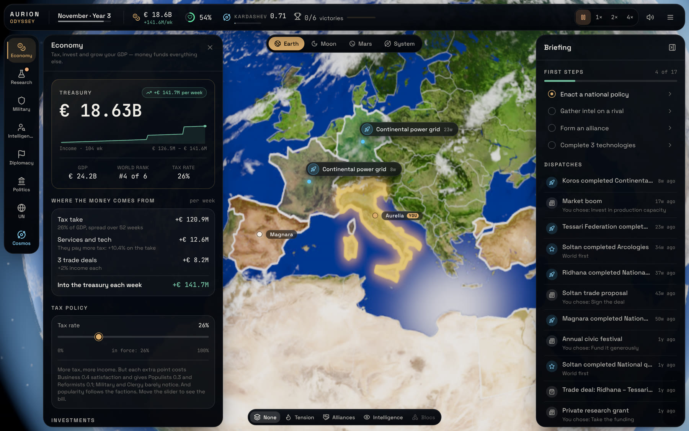
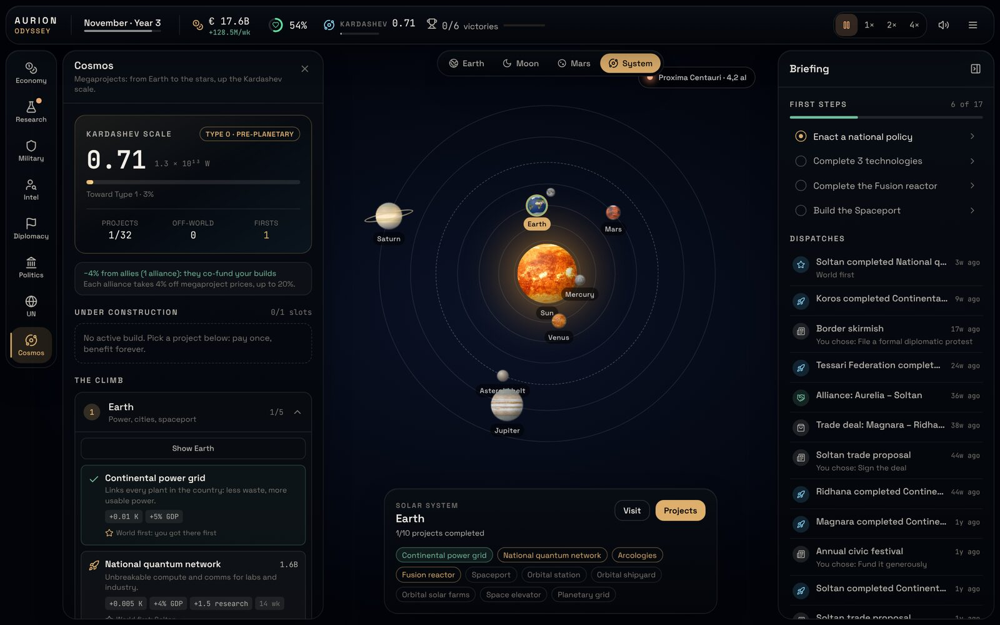
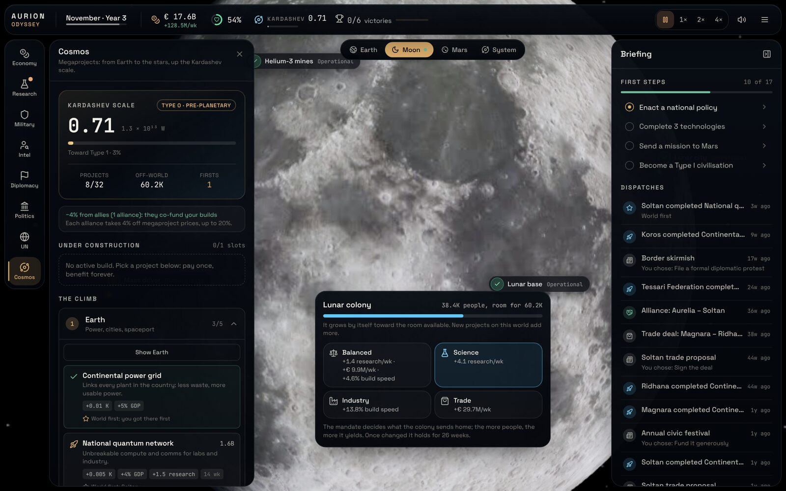
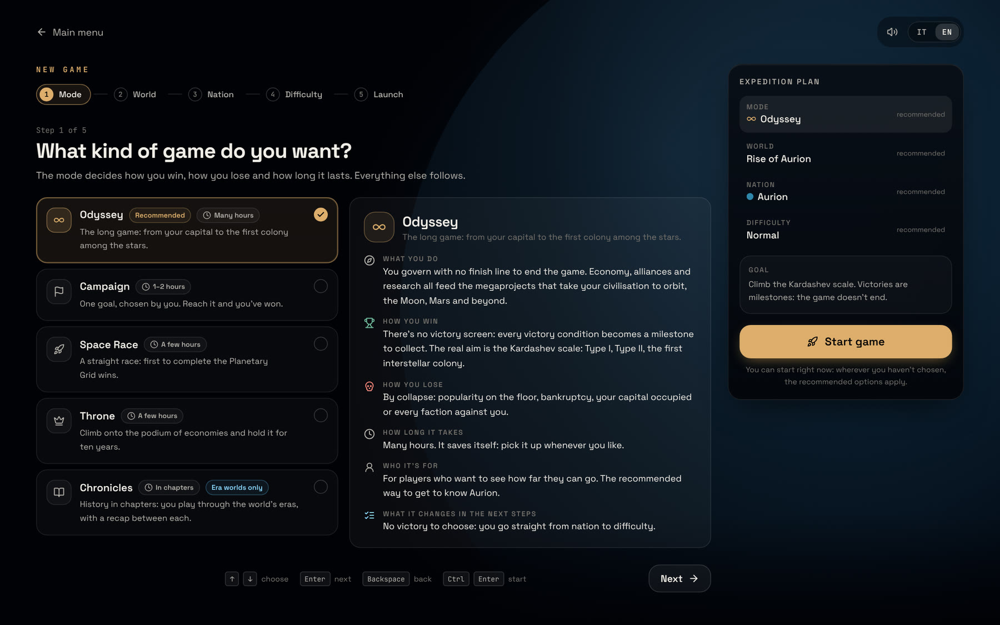

# Aurion

> **Lead a nation. Then a civilisation.** A real-time, pausable grand-strategy game played on a living planet — from your first tax reform to the first colony under another sun.

[](https://github.com/metaforismo/aurion/actions/workflows/ci.yml)
[](./LICENSE)
[](https://pnpm.io/)
[](https://nextjs.org/)
[](https://threejs.org/)
[](https://www.typescriptlang.org/)

Aurion is a single-player browser game with the pacing of *Plague Inc.* — one glance at the whole world, a handful of powerful levers — and a long game borrowed from the Kardashev scale. You start as one country among many. You research, trade, spy, ally and fight your way up. Then you leave: orbit, the Moon, Mars, the belt, a Dyson swarm around the Sun, and a generation ship to Proxima.

It runs entirely in the browser. No backend, no account, no tracking.



| The solar system and the megaproject ladder | The Moon, waiting for your first base | Choosing how to play |
|:---:|:---:|:---:|
|  |  |  |

---

## Contents

- [What you do](#what-you-do)
- [Game modes](#game-modes)
- [The long game](#the-long-game)
- [Quick start](#quick-start)
- [Architecture](#architecture)
- [Project structure](#project-structure)
- [Tests](#tests)
- [Audio](#audio)
- [Credits and licences](#credits-and-licences)
- [Contributing](#contributing)

---

## What you do

**The world is the interface.** The play screen is a satellite globe rendered with Three.js: day and night with city lights, clouds, atmosphere, and a political layer drawn on top. Your country glows gold. Wars, covert operations, UN votes and your rivals' space launches appear as pins where they happen. Click any country for its card and one-tap routes into the systems that act on it.

**Eight systems, one dock.**

| System | What it is for |
| --- | --- |
| Economy | Treasury, taxes with their real political price, five kinds of investment with a live preview |
| Research | Four branches of technology; the space branch gates the megaprojects |
| Military | Forces, deployments and wars that keep score: win battles or simply outmatch the enemy, then sign peace as a draw, for reparations or on a capitulation. A nuclear arsenal where the scenario has one |
| Intelligence | What you know about each rival, and five kinds of covert operation with odds shown up front. Agents come home unless caught, the target you pick changes the effect, and rivals run operations against you too |
| Diplomacy | Treaties, alliances, sanctions, war and peace; blocs and reputation |
| Internal politics | Popularity, five factions, and twelve national policies with weekly trade-offs. Each faction pulls one lever: win it over for a bonus, lose it and it works against you |
| United Nations | Propose and vote on resolutions that bind everyone |
| Cosmos | Megaprojects, the space race and your Kardashev rating |

**Decisions with consequences you can read.** Events stop the clock and show exactly what each choice will do before you pick — from a border skirmish to the day your colonists on Mars ask for a parliament of their own. Every action in every panel states its price and its effect first, and says why when it is unavailable.

**A briefing that always knows the next step.** The right-hand rail walks you from "start a research" to "found a colony on Proxima b", and keeps a running feed of what just happened in the world.

It plays on a phone too: the drawer and the briefing become sheets over the planet.

Big steps get their own moment — the first base on the Moon, the day you become a Type I civilisation — and the pause menu keeps charts of how the run has gone.

Also: four scenarios (a six-nation starter, a fictional continent, the contemporary world, the Cold War), three difficulty presets plus Iron Man, 23 trophies that persist across runs, save / load / export / import, a first-run tour, a full how-to-play codex, and Italian and English throughout.

## Game modes

Picked first, because the mode decides how you win, how you lose and how long it takes.

| Mode | You win by | You lose by | Length |
| --- | --- | --- | --- |
| **Odyssey** (recommended) | There is no ending. Victories become milestones; the goal is the Kardashev ladder | Collapse | Many hours |
| **Campaign** | Reaching the one victory path you chose: economic, military, scientific, diplomatic, domination or ascension (Type I) | Collapse | 1–2 hours |
| **Space Race** | Finishing the Planetary Grid — Kardashev Type I — before anyone else | A rival getting there first, or collapse | A few hours |
| **Throne** | Ten years, in total, among the top three economies | Ten years without reaching the podium, five straight years off it afterwards, or collapse | A few hours |
| **Chronicles** | Living through every era of the scenario | Collapse | Chaptered |

"Collapse" is the same everywhere: popularity on the floor, bankruptcy, your capital occupied, or every faction against you. A won game can be carried on as an Odyssey from the end screen.

## The long game

Thirty-two megaprojects in seven stages: **Earth → Orbit → Moon → Mars → Outer system → the Sun → the stars.** Each is paid up front, takes weeks to build and pays out for ever: more GDP, more research, more of the Sun's energy under your control. Your civilisation's Kardashev rating climbs from 0.70 to Type I (a planet's worth of energy) with the Planetary Grid, to Type II with a Dyson sphere, and a little beyond with the first interstellar colony.

Allies co-fund your builds (4% off per alliance, up to 20%), and milestones bring their own decisions: who owns the Moon, what to do when Mars asks for autonomy. Every other nation climbs the same ladder at its own pace. Being first earns prestige; in Space Race it is the whole game. You can visit the Moon and Mars to see your sites, or open the solar-system map.

## Quick start

You need [Node.js](https://nodejs.org/) 20 or newer and [pnpm](https://pnpm.io/installation) 10.

```bash
git clone https://github.com/metaforismo/aurion.git
```

```bash
cd aurion
```

```bash
pnpm install
```

```bash
pnpm dev
```

Open [http://localhost:3000](http://localhost:3000) and press **Quick play**.

`pnpm dev` builds the engine package first. If you start the web app on its own (`pnpm --filter @aurion/web dev`), build the engine once with `pnpm --filter @aurion/engine build`.

**Graphics.** The planet uses Three.js' WebGPU renderer and falls back to WebGL2 by itself when WebGPU is missing, when only a software adapter is available, or if the GPU device is lost. On slow machines it lowers its own resolution and drops the blur behind the glass panels.

## Architecture

A pnpm + Turborepo monorepo with a hard line between game logic and interface.

- **`packages/engine`** — the game, in pure TypeScript. No React, no DOM. `tick()` and `applyAction()` are pure functions over an immutable `GameState`, driven by a seedable PRNG, so the same seed and the same actions always give the same game. That makes it fast to test (420+ unit and property tests), easy to simulate headlessly, and portable.
- **`apps/web`** — the interface: Next.js 16 (App Router), React 19, Tailwind 4, a Zustand store around the engine, Three.js for the planet, IndexedDB saves (Dexie), `next-intl` for Italian and English.

The engine owns every rule, including how event and technology effects are interpreted, and exposes the same interpretation to the UI (`describeEventEffect`, `getProjectStatus`, `getPolicyStatus`), so what a button promises and what the game does cannot drift apart.

Design notes for the interface are in [`docs/DESIGN.md`](./docs/DESIGN.md). The original design specs are in [`docs/SPEC.md`](./docs/SPEC.md) and its phase 2 / 3 companions.

## Project structure

```
aurion/
├── apps/web/                      # Next.js app (@aurion/web)
│   ├── app/[locale]/              # /, /new, /play/[saveId], /guida, /trofei, /settings
│   ├── components/
│   │   ├── ui/                    # the UI kit every screen is built from
│   │   ├── Globe/                 # planet view, political layer, pins, Moon / Mars / system stages
│   │   ├── Hud/  Briefing/  Modals/  Tutorial/
│   │   ├── Panels/                # the eight systems
│   │   ├── Menu/                  # title screen, new-game flow, codex, settings
│   │   └── Audio/
│   ├── lib/                       # store, ticker, persistence, globe renderer, formatting
│   ├── content/scenarios/         # data-driven scenarios (JSON + IT/EN copy)
│   ├── messages/                  # it.json, en.json (kept in key parity)
│   ├── public/textures/           # planet textures
│   ├── public/audio/              # sound effects and music beds
│   └── tests/                     # Vitest + Playwright
├── packages/engine/               # the game (@aurion/engine)
│   ├── src/
│   │   ├── tick.ts  createGame.ts  checkWinLoss.ts  types.ts
│   │   ├── actions/               # one reducer per player action
│   │   ├── cosmos/                # megaprojects, space race, Kardashev scale
│   │   ├── policies/              # national policies
│   │   ├── events/                # event and technology effects
│   │   └── ai/  un/  blocs/  nuclear/  reputation/  era/  space/
│   ├── tests/
│   └── scripts/                   # headless simulations (sim.ts, sim-cosmos.ts)
├── scripts/
│   ├── audio/                     # regenerates every sound with earshot
│   └── i18n/                      # one file of (key, it, en) copy per UI area
└── docs/                          # DESIGN.md and the design specs
```

## Tests

```bash
pnpm typecheck
```

```bash
pnpm lint
```

```bash
pnpm test
```

```bash
pnpm --filter @aurion/engine sim
```

```bash
pnpm --filter @aurion/web test:e2e
```

`sim` runs headless games; `packages/engine/scripts/sim-cosmos.ts` is the balance probe for the megaproject ladder. The Playwright suite needs `pnpm exec playwright install` once. CI runs typecheck, lint, the engine tests and the web build.

**Adding copy.** Never edit `messages/*.json` by hand. Add `(key, italian, english)` entries to the matching file in `scripts/i18n/` and run it; both bundles are written together.

## Audio

All 28 sound effects and 5 music beds were rendered offline with [earshot](https://github.com/Leonxlnx/earshot), a CPU-only tool that synthesises sound from plain-language requests. `scripts/audio/generate.py` regenerates everything from `scripts/audio/spec.json`. earshot does not compose music, so the beds are ambient underscore — pads, drones and sparse notes — rather than songs. Details and licences are in [`apps/web/public/audio/README.md`](./apps/web/public/audio/README.md).

## Credits and licences

- Code: [MIT](./LICENSE) — © 2026 Francesco Giannicola and Aurion contributors.
- Planet textures: [Solar System Scope](https://www.solarsystemscope.com/textures/) (CC BY 4.0), derived from NASA imagery; the ocean mask comes from [three-globe](https://github.com/vasturiano/three-globe) (MIT). See [`apps/web/public/textures/LICENSES.md`](./apps/web/public/textures/LICENSES.md).
- Fonts: Space Grotesk and JetBrains Mono, bundled under the SIL Open Font License (`apps/web/app/fonts/`).
- Country borders: [Natural Earth](https://www.naturalearthdata.com/) via `world-atlas` (public domain).
- Audio: rendered with earshot; free for any use.

## Contributing

Pull requests are welcome — see [`CONTRIBUTING.md`](./CONTRIBUTING.md) for setup, conventions and how to add a scenario. If you work with an AI coding assistant, point it at [`apps/web/AGENTS.md`](./apps/web/AGENTS.md) and [`docs/DESIGN.md`](./docs/DESIGN.md) first.
